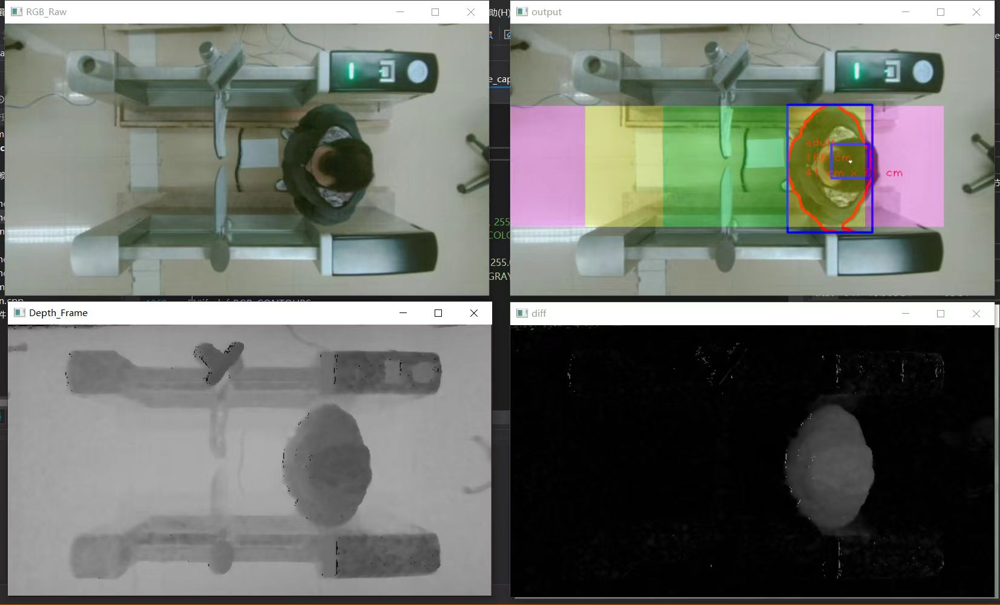
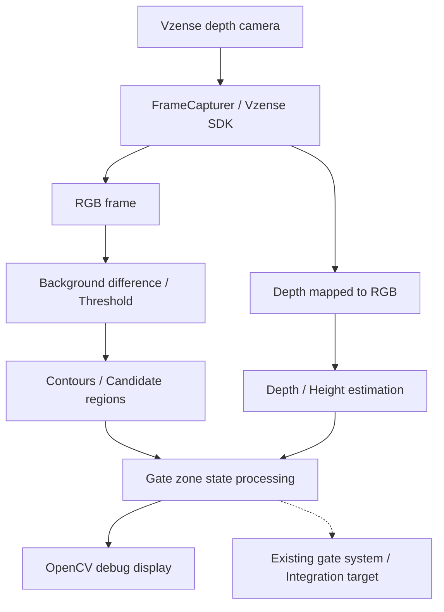
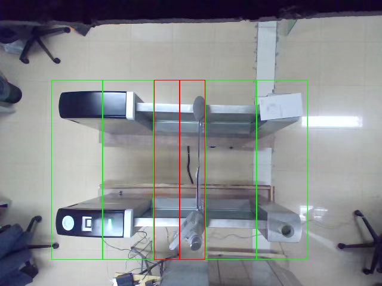
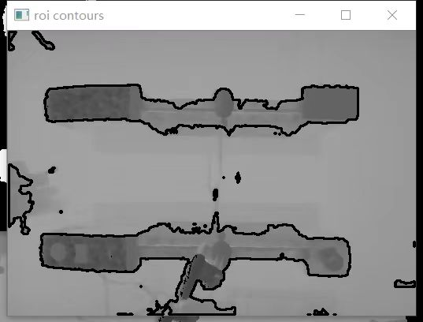
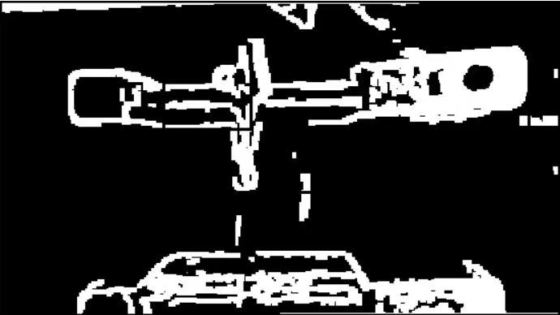
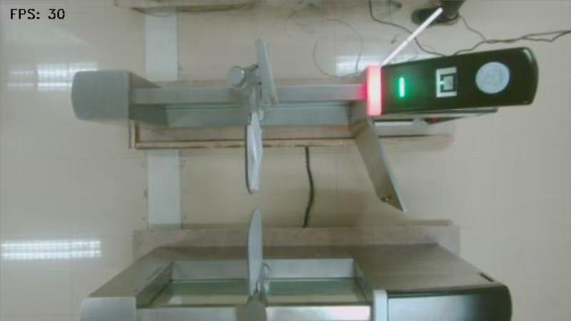
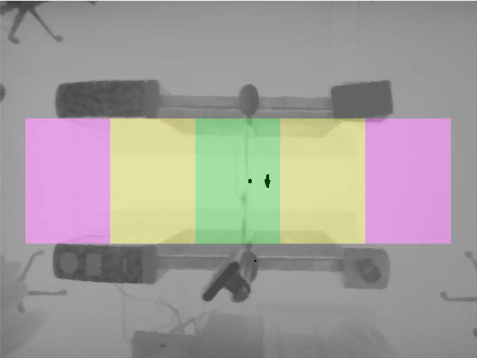
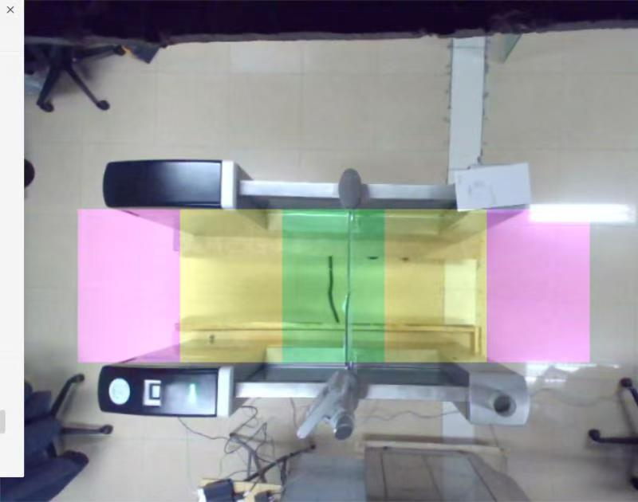

# DepthCamAutoGateMachine

[中文](README.md) | 日本語

**C++・Vzense SDK・OpenCVを用い、3D深度カメラによる自動改札ゲート内の人物・物体検知および通過判定に取り組んだ先行検証（プロトタイプ）モジュールです。**

前職の自動改札機（AFC）関連開発において、従来の赤外線センサー配列による通過検知を「RGB画像＋深度情報」による空間検知方式へ置き換える技術検証として実装しました。Windowsベースの社内検証機上で、既存のゲート制御システムへ組み込み可能な独立スレッドモジュールとして構築しています。

カメラSDKによるストリーム取得、OpenCVによる背景差分・輪郭抽出、深度マップを用いた対象の高さ推定、およびゲート内ゾーンごとの状態管理を組み合わせています。本リポジトリーには、その画像取得・検知アルゴリズムと検証用ホストプログラムを収録しています。

上図は社内検証環境での動作画面です。RGB画像、深度画像、背景差分画像と、検知した対象のバウンディングボックス・領域状態を重ねて可視化しています。

## 開発の目的

- 3D深度カメラから取得したRGB画像と距離（深度）情報を融合し、ゲート通路内の人物・物体検知に活用する。
- 対象の位置・サイズ・高さを組み合わせ、通過判定や大人／子供の識別などに必要なゾーン状態ロジックを検証する。
- カメラ制御と画像処理を独立したワーカースレッドモジュールに封装し、既存の改札機ソフトウェアへ低結合で組み込める構成にする。
- 入力フレームと検知結果をリアルタイム描画し、カメラ設置高や各種閾値のキャリブレーションを行えるようにする。

## 主な実装内容

| 分類 | 内容 |
|---|---|
| カメラ制御 | Vzense SDKの初期化、デバイスの列挙・接続、ストリーム開始、フレーム同期取得 |
| RGB＋深度の統合 | RGBフレームと、SDK側でRGB座標系へアライメント（マッピング）した16bit深度フレームの取得 |
| 候補領域の抽出 | 背景差分、グレースケール変換、二値化、輪郭抽出、外接矩形による対象領域の選別 |
| 高さ推定とゾーン判定 | 深度値とカメラ設置高さからの対象身長・高さ算出、ゲート内分割ゾーンごとの在席状態更新 |
| スレッドモジュール化 | `FrameProcThread`のワーカーループ内でフレーム取得と検知処理を非同期実行 |
| デバッグ可視化 | RGB画像、検知矩形、推定高さラベル、ゾーン境界をOpenCVウィンドウへオーバーレイ表示 |

検知アルゴリズムには、組み込み環境での計算負荷と説明性を考慮し、背景差分・輪郭抽出と深度情報を組み合わせた幾何・画像処理アプローチを採用しています（ディープラーニング推論は不使用）。

## 処理の流れ

点線は既存のゲート制御ソフトウェアとの連携境界を表します。公開スナップショットでは単体検証しやすいよう最小構成としており、実機システム側への状態通知インターフェースは組み込み先に応じて接続します。

## 設計・実装のポイント

### 1. カメラSDK制御層と画像処理層の分離

`FrameCapturer`クラスがVzense SDKを介したデバイス初期化、接続管理、動作モード設定、フレーム取得を担当し、取得データを`cv::Mat`形式のマップとして`FrameProcThread`へ受け渡します。

`FrameProcThread`はワーカーループ管理と空間検知アルゴリズムに専念する構成とし、ハードウェアSDK依存部と画像処理ロジックの責務を分離しています。

### 2. RGB画像からの候補抽出と深度データの融合

処理ループ内で`RGB_Frame`と位置合わせ済みの`MappedDepth_Frame`が揃ったタイミングで`FrameProcessRgbDepth()`を実行します。

`absdiff()`による背景差分、グレースケール変換、`threshold()`による二値化、`findContours()`による輪郭抽出、`boundingRect()`による面積・形状フィルタリングを経て候補領域を特定し、対応ピクセル領域の深度データとゲート寸法定義を照合して対象の高さおよび通路内位置を算出します（モルフォロジー変換の`erode()`／`dilate()`も検証コードとして保持しています）。

### 3. ゲート通路内ゾーンとしての状態管理

単に画像上の矩形を検出するだけでなく、ゲート通路を複数の論理ゾーンに分割し、外接矩形との重なり率や推定高さに基づいて各ゾーンの占有状態を更新します。

カメラの設置高さ、通路幅、ゾーン座標、判定閾値は検証用ゲート筐体の実寸を基準にパラメーター化しており、画面上の`adult`等のラベルも深度ベースの高さ閾値判定によるデバッグ出力です。

### 4. 既存ゲートソフトウェアへの組み込みを考慮したスレッド設計

`FrameProcThread::Start()`で専用ワーカースレッドを起動し、メインの改札制御スレッドをブロックせずにフレーム取得・検知を継続実行します。`main.cpp`にはデバイスインデックスを指定して単体起動・動作確認できるエントリーポイントを用意しています。

## ソースコードの見どころ

| ファイル | 役割 |
|---|---|
| [main.cpp](main.cpp) | デバイスの選択と検知スレッドモジュールの起動 |
| [frame_capturer.h](frame_capturer.h) / [frame_capturer.cpp](frame_capturer.cpp) | Vzense SDKの初期化・接続・設定と各種フレーム取得 |
| [frame_proc_thread.h](frame_proc_thread.h) | 検知モジュールのインターフェース、ゾーン定義・閾値・内部状態 |
| [frame_proc_thread.cpp](frame_proc_thread.cpp) | `Loop()`、ゾーン初期化、`FrameProcessRgbDepth()`、高さ推定、デバッグ描画 |
| [FrameProcThread.sln](FrameProcThread.sln) / [FrameProcThread.vcxproj](FrameProcThread.vcxproj) | Visual Studioソリューションおよびビルド設定 |

起動から検知ロジックまでの流れは`main.cpp` → `FrameProcThread::Start()` → `Loop()` → `FrameProcessRgbDepth()`の順に追うことができます。

## 使用技術

| 技術 | 用途 |
|---|---|
| C++ | カメラ制御、フレーム管理、検知アルゴリズム・ゾーン状態処理 |
| Vzense SDK | RGB・深度ストリーム取得、座標アライメント、デバイス設定 |
| OpenCV | 背景差分・二値化・輪郭抽出、行列演算、デバッグオーバーレイ描画 |
| `std::thread` / `std::mutex` | ワーカースレッド管理および共有状態の排他制御 |
| Visual Studio 2019 / MSVC v142 | ソリューションおよびビルド環境 |
| Windows SDK 10.0 | Windowsターゲット設定 |

## ビルドと実行の準備

付属プロジェクトはWindows（`x64`構成）向けです。環境に合わせて[FrameProcThread.vcxproj](FrameProcThread.vcxproj)のインクルードパス・ライブラリーパスを調整してください。

### 必要なもの

- Vzense対応3D深度カメラ実機およびデバイスドライバー。
- `Vzense_api2.h`を含むSDKヘッダー、`vzense_api.lib`、および実行時DLL。
- OpenCVヘッダー、リンク用ライブラリー、実行時DLL（現在の設定は`opencv_world3416.lib`／`opencv_world3416d.lib`を参照）。
- MSVC v142およびWindows SDK 10.0が利用可能なVisual Studio環境。

※外部SDKおよびライブラリー本体はリポジトリーに含めていません。

### セットアップ手順

1. `FrameProcThread.sln`を開き、`x64`のDebugまたはRelease構成を選択します。
2. 追加のインクルードディレクトリー（`../../Include`）およびライブラリーディレクトリー（`../../Lib/x64`）を配置先に合わせて変更します。
3. 出力先（既定では`../../Bin/x64`）へOpenCVおよびVzense SDKの実行時DLLを配置します。
4. 実機の設置高さ・通路寸法に合わせて、対象領域の座標および閾値パラメーターを調整します。

## スコープと注意事項

本リポジトリーは、前職における3Dカメラ導入に向けた先行技術検証（プロトタイプ実装）のスナップショットであり、社内テスト用ゲート環境での機能検証を対象としたものです（駅構内での本番量産稼働コードではありません）。

実運用環境へ展開する場合は、以下の項目について設置条件に応じた追加実装・調整が必要となります。

- 背景フレームと入力フレームのチャンネル整合性チェック、および初期化シーケンスの厳密化。
- 内部状態変数（`area_status_`）と外部公開用ゲッター（`GetAreasStatus()`が返す`areas_status_`）の同期整理。
- カメラ切断時の自動再接続およびスレッド終了シーケンスの堅牢化。
- 密着通過（共連れ）・遮蔽・逆行・環境光急変などのエッジケースに対するフィールド評価。

## 検証時の動作画面

ゲート通路内の論理ゾーン設定と、実際の検知テスト時に記録した動作キャプチャーです。

その他の動作画面を開く

