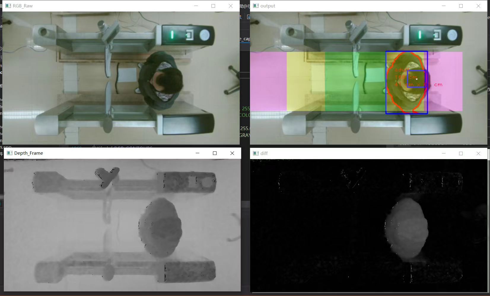
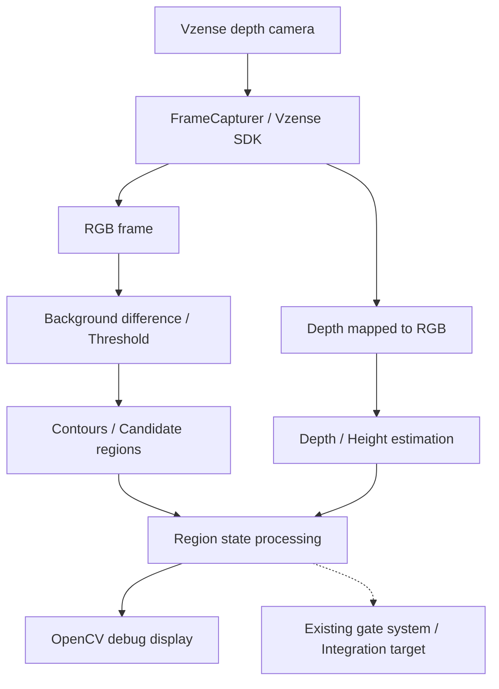
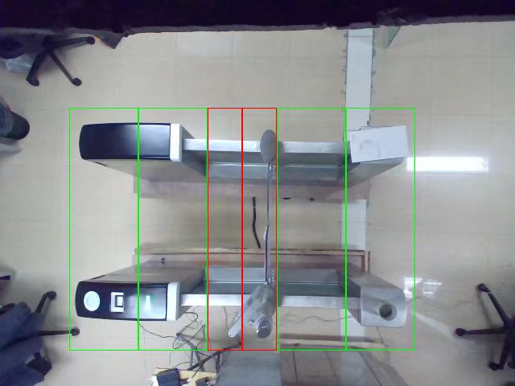
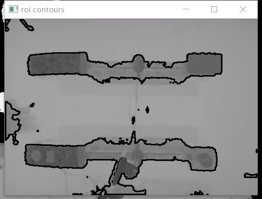
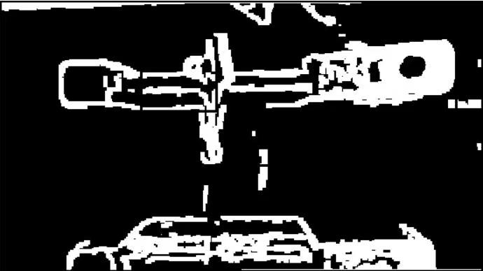
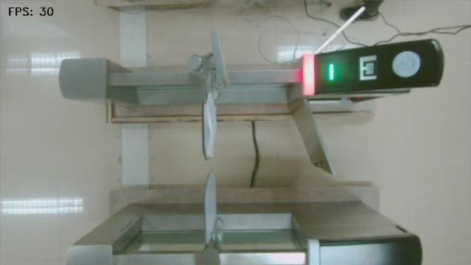
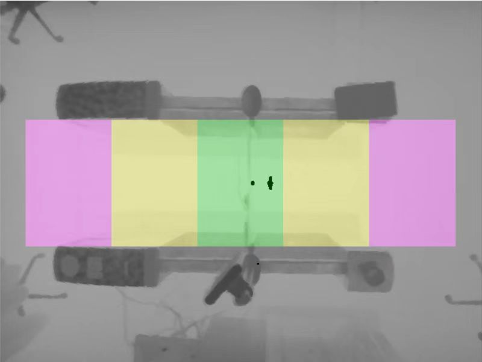
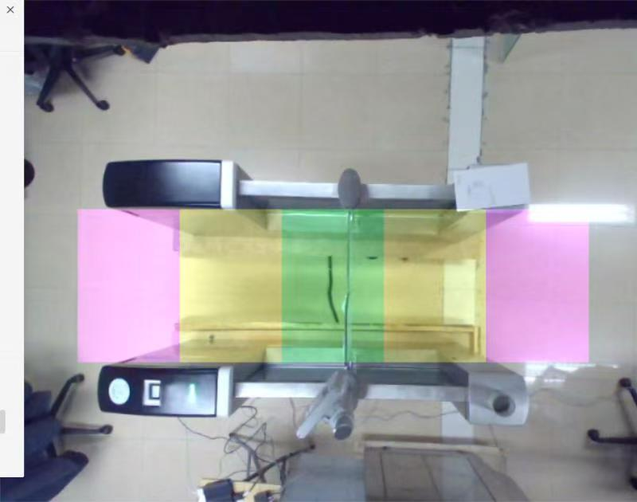

# DepthCamAutoGateMachine

[中文](README.md) | 日本語

**C++・Vzense SDK・OpenCVを使い、深度カメラによるゲート内の対象検出と通過判定に取り組んだ実験プロジェクトです。**

前職で取り組んだプロジェクトで、Windowsの実験室用開発機上で、深度カメラの処理をスレッドモジュールとして既存のゲートシステムへ組み込みました。従来のセンサーによる通過検出を、画像と深度情報を使う方式へ置き換えるための検証です。

カメラSDKによる画像取得、OpenCVによる候補領域の抽出、深度を使った高さの推定、ゲート内の領域ごとの状態処理を組み合わせています。このリポジトリーには、その画像取得・処理コードと検証用プログラムを収録しています。

上図は実験時の画面です。RGB画像、深度画像、差分画像と、対象の輪郭・領域を重ねた表示を確認できます。

## 開発の目的

- 深度カメラから取得したRGB画像と距離情報を、ゲート内の対象検出に利用する。
- 対象の位置・大きさ・高さを組み合わせ、通過判定に必要な領域状態を検討する。
- 画像取得と処理をスレッドモジュールにまとめ、既存のゲートシステムへ組み込む。
- 元画像と処理結果を表示し、設置条件や閾値を調整しながら検証する。

## 主な実装内容

| 分類 | 内容 |
|---|---|
| カメラ接続 | Vzense SDKの初期化、機器の列挙・接続、ストリーム開始、フレーム取得 |
| RGBと深度の利用 | RGB画像と、SDKでRGB側へマッピングした16ビット深度画像の取得 |
| 候補領域の抽出 | 背景との差分、グレースケール化、二値化、輪郭抽出、外接矩形による選別 |
| 高さと位置の処理 | 深度値、カメラの設置高さ、ゲート内の領域を使った対象の状態処理 |
| スレッド化 | `FrameProcThread`の処理ループ内で画像取得と検出処理を実行 |
| 検証用表示 | RGB画像、検出領域、推定値などをOpenCVのウィンドウへ表示 |

検出処理は、背景差分・閾値・輪郭と深度情報を組み合わせた方式です。学習済みモデルを使う物体認識は採用していません。

## 処理の流れ

画像処理の役割を整理した図です。点線は既存システムとの接続先を表します。公開コードの状態出力APIと組み込み先の処理は、再利用時に接続を確認する必要があります。

## 設計・実装で取り組んだこと

### 1. カメラSDKと画像処理の役割分担

`FrameCapturer`は、Vzense SDKを通じた機器の初期化、接続、取得モードの設定、フレーム取得を担当します。取得した画像を`cv::Mat`として扱い、フレーム名をキーとするマップを通して`FrameProcThread`へ渡します。

`FrameProcThread`は、処理ループと検出処理を担当します。SDKによる機器操作と、取得画像から対象を調べる処理を別のクラスに分けています。

### 2. RGB画像から候補を抽出し、深度を組み合わせる

現在の処理ループでは、`RGB_Frame`と`MappedDepth_Frame`がそろうと、`FrameProcessRgbDepth()`を呼び出します。

この関数には、`absdiff()`による背景との差分、グレースケール変換、`threshold()`による二値化、`findContours()`による輪郭抽出、`boundingRect()`による領域の選別を記述しています。さらに、対応する深度データとゲートの領域情報を参照し、高さや位置に関する処理を行う構成です。

収縮・膨張の処理も検討用コードとして残っていますが、この経路の`erode()`と`dilate()`はコメントアウトされています。

### 3. 検出結果をゲート内の領域状態として扱う

画像全体から対象を見つけるだけでなく、ゲートのどの領域に候補があるかを調べます。外接矩形と領域の重なり、深度から求める高さなどを使い、内部の領域状態を更新する実装です。

カメラの設置高さ、ゲート寸法、領域の座標、各種閾値には実験環境を前提とする値が含まれています。再利用時は設置条件に合わせた調整が必要です。画面中の`adult`などのラベルも、高さの閾値に基づく検証用の表示です。

### 4. 既存システムへ組み込むためのスレッドモジュール

`FrameProcThread::Start()`からワーカースレッドを起動し、そのループ内で画像取得と処理を順に実行します。取得専用スレッドと処理専用スレッドを分けた構成ではなく、一つの処理モジュールとして既存システムへ組み込むことを目的としています。

`main.cpp`には、デバイス番号を指定してモジュールを起動する検証用の入口を用意しています。

## ソースコードの見どころ

| ファイル | 役割 |
|---|---|
| [main.cpp](main.cpp) | デバイスの選択と処理スレッドの起動 |
| [frame_capturer.h](frame_capturer.h) / [frame_capturer.cpp](frame_capturer.cpp) | SDKの初期化・接続・設定と各種フレームの取得 |
| [frame_proc_thread.h](frame_proc_thread.h) | 処理モジュールのインターフェース、領域・閾値・内部状態 |
| [frame_proc_thread.cpp](frame_proc_thread.cpp) | `Loop()`、領域初期化、`FrameProcessRgbDepth()`、高さの計算、検証用表示 |
| [FrameProcThread.sln](FrameProcThread.sln) / [FrameProcThread.vcxproj](FrameProcThread.vcxproj) | Visual Studioのソリューションとビルド設定 |

最初に`main.cpp`から`FrameProcThread::Start()`、`Loop()`、`FrameProcessRgbDepth()`の順に読むと、起動から画像処理までの流れを追えます。カメラとのやり取りは`FrameCapturer`で確認できます。

## 使用技術

| 技術 | 用途 |
|---|---|
| C++ | カメラ制御、画像データの管理、検出・領域状態の処理 |
| Vzense SDK | RGB・深度フレームの取得、マッピング、カメラ設定 |
| OpenCV | 画像の差分・二値化・輪郭抽出、行列操作、検証用表示 |
| `std::thread` / `std::mutex` | 処理スレッドの実行と一部の共有状態の保護 |
| Visual Studio 2019 / MSVC v142 | 付属ソリューションのビルド環境 |
| Windows SDK 10.0 | Windows向けのビルド設定 |

## ビルドと実行の準備

付属プロジェクトはWindows向けです。外部依存の参照が設定されている`x64`構成を基準に、[FrameProcThread.vcxproj](FrameProcThread.vcxproj)を使用環境に合わせて調整します。

### 必要なもの

- Vzenseの対応カメラと、その機種・SDKに必要な実行環境。
- `Vzense_api2.h`を含むSDKヘッダー、`vzense_api.lib`、対応する実行時DLL。
- OpenCVのヘッダー、リンク用ライブラリー、実行時DLL。現在の設定はReleaseで`opencv_world3416.lib`、Debugで`opencv_world3416d.lib`を参照しています。
- MSVC v142とWindows SDK 10.0を利用できるVisual Studio環境。

これらのSDK・外部ライブラリーは、このリポジトリーには含まれていません。

### 設定の確認

1. `FrameProcThread.sln`を開き、`x64`のDebugまたはReleaseを選択します。
2. 追加のインクルードディレクトリー`../../Include`と、ライブラリーディレクトリー`../../Lib/x64`を、実際の依存ファイルの場所へ変更します。
3. OpenCVとVzense SDKのアーキテクチャー・構成を合わせ、必要なDLLを配置します。現在の出力先設定は`../../Bin/x64`です。
4. デバイス番号、取得モード、RGBと深度のマッピング設定、カメラの設置条件、検出領域と閾値を確認します。

本READMEの作成時はソースコードと設定を確認しており、依存ファイルをそろえたビルドやカメラを接続した実行は行っていません。公開コードには検証途中の部分があるため、次の項目も確認したうえで再実行してください。

## 現在の範囲

前職の実験プロジェクトで扱った、カメラSDKの組み込み、RGBと深度を組み合わせる画像処理、既存機器への接続を検討するためのコードです。検証範囲は実験室の開発機と既存ゲートへの組み込みであり、量産環境での運用を示すものではありません。

公開スナップショットには、次の整理・再確認が必要な箇所があります。

- 背景画像と入力画像のチャンネル数の整合、および高さの計算で参照する画像の初期化。
- 内部の領域状態`area_status_`と、`GetAreasStatus()`が返す`areas_status_`の接続。
- 検証用プログラムの終了処理と、切断・再接続を含むスレッドのライフサイクル。

複数人、遮蔽、逆方向の移動、照明変化、異常時の機器動作については、利用条件に応じた追加検証が必要です。認識率や処理速度のベンチマークは掲載していません。

## その他の実験画面

ゲート内の領域設定と、実験時に保存した表示例です。

その他の表示例を開く

