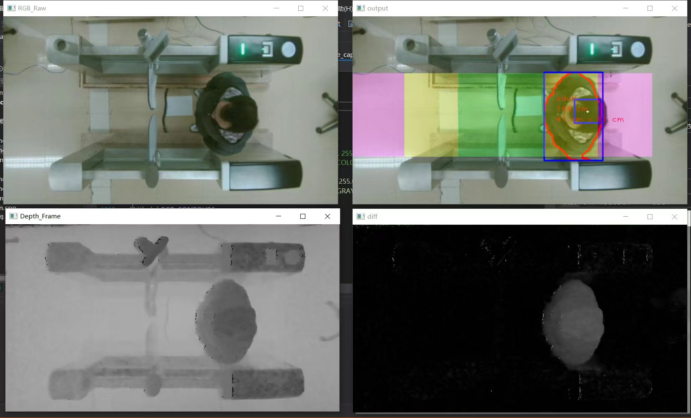
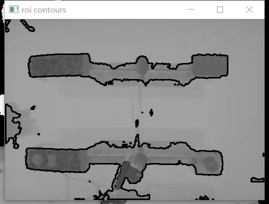
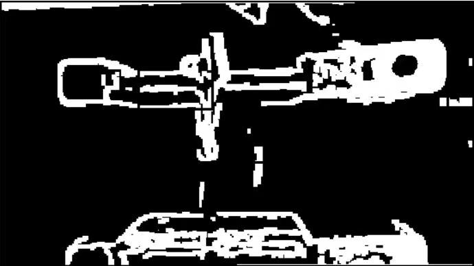
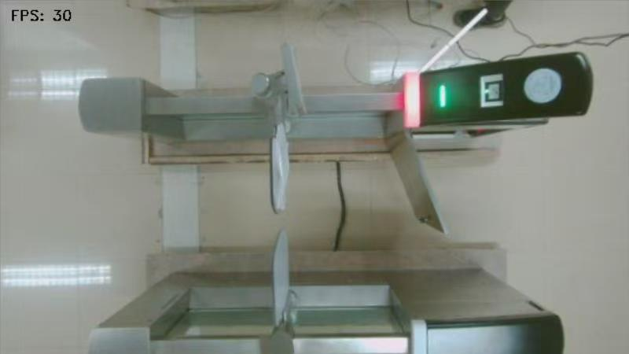
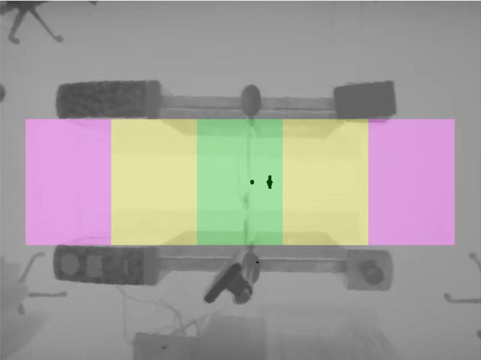
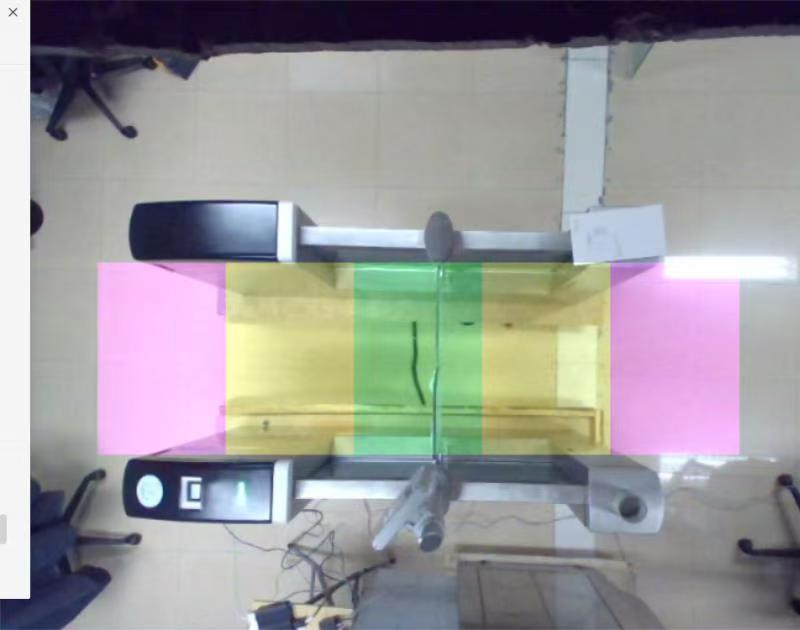
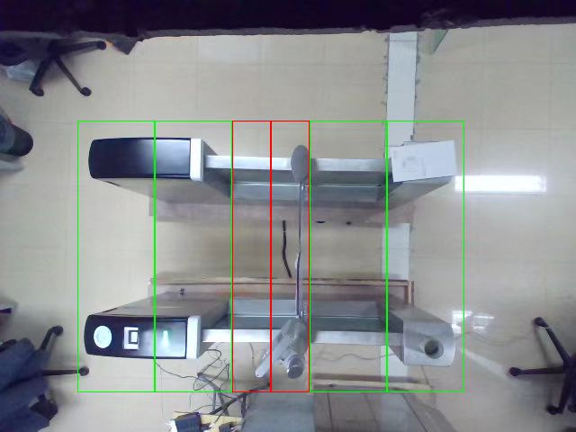

# DepthCamAutoGateMachine

中文 | [日本語](README.ja.md)

这是我在前公司参与的地铁闸机视觉检测预研（原型验证）项目。
本项目基于 Windows 平台，使用 C++、OpenCV 以及 Vzense 3D 深度摄像头 SDK，实现自动检票闸机通道内的目标检测与通行状态判定。

本项目作为独立的多线程检测模块接入既有闸机软件系统，在内部测试样机上完成了“RGB 图像 + 深度信息”替代传统红外传感器阵列的通行检测方案验证。

以下是实测效果图：

